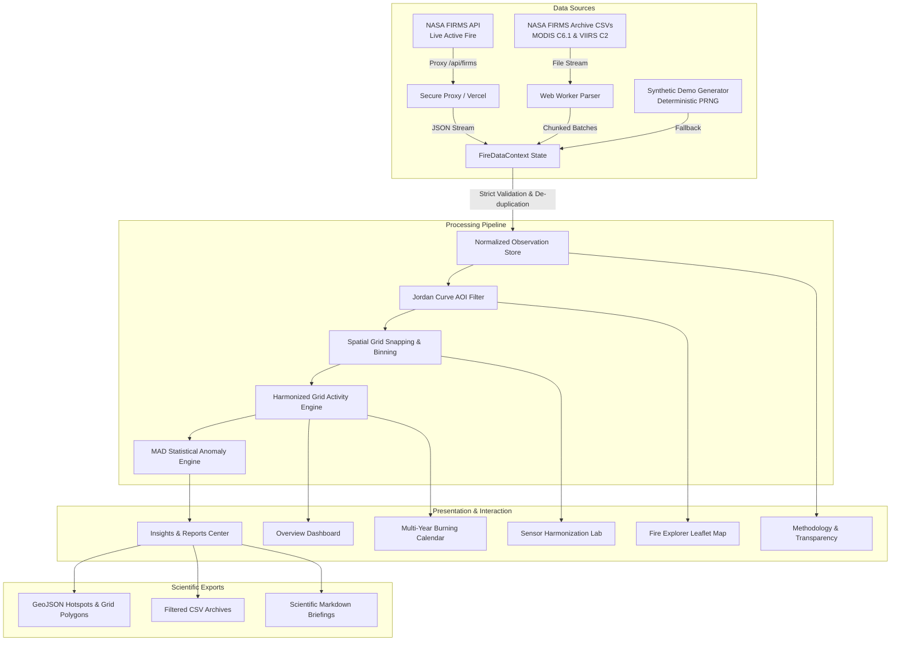

# PyroLens — A Harmonized NASA Fire Activity Intelligence Platform

[](https://www.spaceappschallenge.org/)
[](https://www.typescriptlang.org/)
[](https://vitejs.dev/)
[](https://react.dev/)
[]()

> **SCIENTIFIC NOTICE & DISCLAIMER**
> **PyroLens** is an open-source educational and scientific intelligence platform developed for the **NASA Space Apps Challenge** (*Harmonization of MODIS and VIIRS Hot Spots*). It is not officially endorsed by NASA. Satellite hotspots represent detected mid-infrared thermal anomalies, not confirmed wildfires, fire perimeters, or burned area. Do not use for tactical emergency or life-safety decisions.

---

## 1. Project Purpose & Challenge Alignment

### The Scientific Challenge
Earth-observing satellites have tracked active fire hotspots for over two decades. However, the global record is split across distinct sensor generations:
1. **MODIS (Moderate Resolution Imaging Spectroradiometer)** on NASA Terra & Aqua satellites: Operating since 2000, nadir pixel footprint of **1 km (1,000 m)**.
2. **VIIRS (Visible Infrared Imaging Radiometer Suite)** on Suomi-NPP, NOAA-20, & NOAA-21: Operating since 2012, nadir pixel footprint of **375 m (I-band)**.

Because a single 1 km MODIS pixel footprint encompasses approximately **nine (9) 375 m VIIRS pixels**, VIIRS detects significantly smaller, cooler, and fragmented fires. **Directly adding or comparing raw MODIS and VIIRS hotspot counts creates severe artificial surges and misleads fire managers.**

### The PyroLens Solution
**PyroLens** delivers a scientifically defensible platform that:
- **Replaces misleading count summation** with a **Harmonized Grid Activity Index** ($H_t = |\bigcup_s \text{ActiveCells}_s|$) across configurable spatial resolutions ($0.10^\circ, 0.25^\circ, 0.50^\circ$).
- **Enables multi-year calendar comparison (2020–2026)** to evaluate burning seasons across historical archives without sensor bias.
- **Supports interactive custom Area of Interest (AOI) polygon drawing** with in-browser ray-casting point-in-polygon filtering and GeoJSON boundary import/export.
- **Applies non-parametric Median Absolute Deviation (MAD)** anomaly detection to distinguish genuine seasonal surges from baseline noise without outlier contamination.
- **Streams large NASA FIRMS CSV archives** via an asynchronous Web Worker parser with duplicate suppression, avoiding browser UI thread freezes.
- **Exports standards-compliant GeoJSON FeatureCollections**, clean CSV datasets, and Markdown scientific briefings.

---

## 2. Architecture Overview

PyroLens employs a modular, client-first geospatial architecture optimized for high-performance in-browser analytics, supplemented by a secure reverse proxy for live NASA FIRMS API ingestion.



---

## 3. Technology Stack

- **Core Framework:** [React 19](https://react.dev/) & [TypeScript 5.9](https://www.typescriptlang.org/) (Strict mode, `noUncheckedIndexedAccess`, zero implicit `any`)
- **Build Engine & Bundler:** [Vite 8](https://vitejs.dev/) with Rollup chunking and code splitting
- **Styling & Design System:** [Tailwind CSS 4](https://tailwindcss.com/) with custom CSS tokens (`--color-ember-*` for thermal active fires, `--color-signal-*` for VIIRS sensor analytics, dark high-contrast theme)
- **Geospatial Mapping:** [Leaflet](https://leafletjs.com/) and [React Leaflet](https://react-leaflet.js.org/) with CartoDB/OpenStreetMap tiles, custom SVG markers, and FRP scaling
- **Data Visualization:** [Recharts](https://recharts.org/) (Responsive Area, Bar, and Scatter charts with accessible SVG rendering)
- **Asynchronous Processing:** Native Web Workers (`src/workers/csvParser.worker.ts`) for non-blocking multi-megabyte CSV streaming
- **Unit & Integration Testing:** [Vitest 5](https://vitest.dev/) (23 automated test suites)
- **Iconography:** [Lucide React](https://lucide.dev/)

---

## 4. Key Features & Scientific Methods

### 4.1 Harmonized Grid Activity Index
Rather than naively adding raw detection counts from sensors with disparate pixel resolutions (1 km vs 375 m), PyroLens snaps all observations to a uniform spatial grid:
$$\text{Cell ID} = \lfloor \text{lat} / R \rfloor \times R \;\|\; \lfloor \text{lng} / R \rfloor \times R \quad (R \in \{0.10^\circ, 0.25^\circ, 0.50^\circ\})$$
For any temporal window $t$ (e.g. daily, monthly):
- $\mathcal{S}_{\text{MODIS}} = \text{set of distinct active grid cells observed by MODIS}$
- $\mathcal{S}_{\text{VIIRS}} = \text{set of distinct active grid cells observed by VIIRS}$
- **Harmonized Grid Activity Index:**
  $$H_t = |\mathcal{S}_{\text{MODIS}} \cup \mathcal{S}_{\text{VIIRS}}|$$
- **Coincident Detection Cells:** $\mathcal{S}_{\text{both}} = \mathcal{S}_{\text{MODIS}} \cap \mathcal{S}_{\text{VIIRS}}$
- **Jaccard Spatial Agreement Index:**
  $$J = \frac{|\mathcal{S}_{\text{MODIS}} \cap \mathcal{S}_{\text{VIIRS}}|}{|\mathcal{S}_{\text{MODIS}} \cup \mathcal{S}_{\text{VIIRS}}|}$$

This index is physically meaningful, robust against sensor replacement, and provides a continuous baseline across the 2000–2026 multi-decade record.

### 4.2 Multi-Year Burning Calendar Matrix (2020–2026)
- **Daily View:** Interactive heatmap for any month with color-coded intensity, day inspection, and one-click deep-link to view that specific day on the geospatial map.
- **Multi-Year Matrix:** Side-by-side day-by-day comparison of any selected calendar month across 2020, 2021, 2022, 2023, 2024, 2025, and 2026.
- **Leap Year & Coverage Handling:** Explicit handling of February 29 leap days and visual badges designating partial observational years (e.g., 2026 through October).

### 4.3 Interactive Custom Area of Interest (AOI)
- **Click-to-Draw Polygon:** Users can click on the Leaflet map to place polygon vertices with real-time polyline preview and closure snapping.
- **Jordan Curve Point-in-Polygon Filtering:** Implements ray-casting intersection to test whether every fire observation falls strictly inside the custom boundary:
  ```typescript
  isPointInPolygon([obs.latitude, obs.longitude], aoi.points)
  ```
- **GeoJSON Boundary Upload & Download:** Users can upload custom `.geojson` polygons or download their drawn boundary with complete coordinate rings.

### 4.4 Non-Parametric Anomaly Detection (MAD)
Standard deviation ($\mu \pm k\sigma$) fails on fire data because severe wildfire surges artificially inflate both the mean and variance, masking genuine anomalies. PyroLens uses Median Absolute Deviation:
$$\text{MAD} = \text{median}(|x_i - \tilde{x}|)$$
$$\text{Threshold} = \tilde{x} + (k \times 1.4826 \times \text{MAD})$$
Where:
- $\tilde{x}$ is the sample median across the baseline period.
- $1.4826$ is the asymptotic scale factor for normal distribution consistency.
- $k \in \{2.0, 2.5, 3.0\}$ corresponds to Sensitive, Standard, and Extreme surge thresholds.
- Requires a minimum baseline of 10 observation days to prevent small-sample artifacts.

### 4.5 Standardized Scientific Exports
- **Hotspots GeoJSON:** WGS84 `Point` FeatureCollection with complete satellite metadata (`instrument`, `satellite`, `confidence`, `frp`, `daynight`, `provenance`).
- **Harmonized Grid Cells GeoJSON:** `Polygon` FeatureCollection bounding each active grid bin with sensor count breakdowns and aggregated FRP.
- **Custom AOI GeoJSON:** Closed polygon feature matching the user's drawn boundary.
- **Observation & Daily Aggregate CSVs:** RFC 4180-compliant CSV files with numeric coordinate formatting and ISO dates.
- **Markdown Scientific Briefing:** Self-contained Markdown summary detailing active filters, spatial indices, detected anomalies, and data citations.

---

## 5. Verified NASA Datasets & Large Archive Handling

The project repository includes genuine NASA FIRMS archives for India covering **2020-01-01 through 2026-10-22**:

| Filename | Product / Sensor | Date Range | Size / Rows | Status |
| --- | --- | --- | --- | --- |
| `fire_archive_M-C61_829743.csv` | MODIS Collection 6.1 Standard Archive | 2020-01-01 to 2026-07-31 | 45.7 MB (~500,000 rows) | Verified |
| `fire_nrt_M-C61_829743.csv` | MODIS Collection 6.1 Near-Real-Time (NRT) | 2026-08-01 to 2026-10-22 | 213 KB (2,506 rows) | Verified |
| `fire_archive_SV-C2_829744.csv` | Suomi-NPP VIIRS Collection 2 Standard Archive | 2020-01-01 to 2026-06-30 | 331.7 MB (~3,100,000 rows) | Verified |
| `fire_nrt_SV-C2_829744.csv` | Suomi-NPP VIIRS Collection 2 Near-Real-Time (NRT) | 2026-07-01 to 2026-10-22 | 2.0 MB (24,058 rows) | Verified |

### Non-Blocking Web Worker Processing
Loading a 331 MB CSV into the main JavaScript thread causes severe UI freezes. PyroLens processes archives using:
1. **`src/workers/csvParser.worker.ts`:** Parses input text off the main thread in 2,500-row chunks, dispatching progressive progress events (`progress`, `complete`, `error`).
2. **De-duplication Key:**
   $$\text{Key} = \text{sensor} : \text{lat}_{.4f} : \text{lng}_{.4f} : \text{acqDate} : \text{acqTime}$$
   Suppresses duplicate records when archives overlap with near-real-time files.
3. **Safety Capping:** Enforces a configurable safe row ceiling (default 50,000 rows in browser memory) with transparent user warnings when archive limits are reached.

---

## 6. Installation & Local Development

### Prerequisites
- **Node.js:** `^20.19.0` or `>=22.12.0`
- **npm:** `^10.0.0`

### Setup Instructions
```bash
# 1. Clone the repository
git clone https://github.com/SATHISH3-10/pyrolens.git
cd pyrolens

# 2. Install dependencies
npm install

# 3. Configure environment variables (optional for live API)
cp .env.example .env

# 4. Start the local development server
npm run dev
```
The application will launch at `http://localhost:5173/`.

---

## 7. Configuration & Environment Variables

| Variable Name | Exposure | Required | Description |
| --- | --- | --- | --- |
| `VITE_NASA_FIRMS_MAP_KEY` | Client-side (Optional) | No | Optional 32-character FIRMS MAP_KEY for direct development testing. |
| `FIRMS_MAP_KEY` | Server-side Only (Production) | Optional | Server-side key used in Vercel serverless / backend reverse proxies. Never exposed in client bundles. |

> **Security Rule:** Never commit real API keys to version control. The repository includes `.env.example` with blank placeholders.

---

## 8. Verification & Test Suite

PyroLens features a comprehensive automated test suite powered by [Vitest](https://vitest.dev/):

```bash
# Run the automated unit test suite
npm run test

# Run strict TypeScript compiler verification without emitting
npm run typecheck

# Build optimized production bundle
npm run build
```

### Test Coverage (23 Tests Passing)
- **Data Filtering & Envelopes:** Date boundary clipping, sensor selection, confidence thresholding, regional bounding envelope filtering.
- **Harmonized Grid Binning:** Dynamic resolution snapping ($0.10^\circ, 0.25^\circ, 0.50^\circ$), cell ID formatting, spatial agreement calculations.
- **Cross-Sensor Harmonization:** Coincident cell classification, Jaccard similarity index, detection multipliers, prevention of raw count summation.
- **Multi-Year Calendar Aggregation:** Cross-year month aggregation, leap day handling (Feb 29), missing date handling, partial coverage flagging.
- **Custom AOI & Jordan Curve Theorem:** Convex and concave polygon point-in-polygon filtering, edge points, exterior exclusion.
- **Statistical Anomaly Detection (MAD):** Baseline median calculation, zero-MAD safety fallback, surge detection, minimum sample threshold enforcement.
- **De-duplication & Ingestion:** Suppression of duplicate records across overlapping archive/NRT files.
- **Scientific GeoJSON Exports:** GeoJSON FeatureCollection structure, coordinate ordering (`[lng, lat]` WGS84 standard), polygon closure.

---

## 9. Production Build & Optimization

The application is optimized for fast load times and minimal initial bundle size through route-level code splitting:

```bash
npm run build
```

### Build Artifacts & Code Splitting Measurements
```
dist/index.html                                   0.66 kB │ gzip:   0.39 kB
dist/assets/index-CDChduLs.css                   60.19 kB │ gzip:  14.41 kB
dist/assets/info-CPBaHrPt.js                      0.23 kB │ gzip:   0.19 kB
dist/assets/exportUtils-B-PEe6rF.js               7.04 kB │ gzip:   2.88 kB
dist/assets/FilterBar-BZ309-N8.js                 9.96 kB │ gzip:   2.82 kB
dist/assets/HarmonizationPage-z9_LTn5d.js        18.17 kB │ gzip:   5.04 kB
dist/assets/HistoricalCalendarPage-DRzDP5TJ.js   19.94 kB │ gzip:   5.07 kB
dist/assets/MethodologyPage-CKAkc2vu.js          21.57 kB │ gzip:   6.26 kB
dist/assets/InsightsReportsPage-C4dcEgPX.js      25.52 kB │ gzip:   6.91 kB
dist/assets/OverviewPage-D2LtYmb3.js             37.37 kB │ gzip:  10.34 kB
dist/assets/FireExplorerPage-BUW2Kifx.js        176.32 kB │ gzip:  50.95 kB
dist/assets/index-P51vTQUs.js                   321.10 kB │ gzip: 101.77 kB
dist/assets/BarChart-CPhvfV4p.js                373.16 kB │ gzip: 107.39 kB
```
- **Heavy Leaflet map dependencies** are isolated to `FireExplorerPage` (176 kB).
- **Heavy charting engines** are deferred via dynamic imports.
- Total gzipped initial landing page payload is **~116 kB**.

---

## 10. Deployment Instructions (Vercel)

The repository includes a production-ready [`vercel.json`](file:///e:/Nasa/PyroLens_Part1/pyrolens/vercel.json) configuration:

```json
{
  "$schema": "https://openapi.vercel.sh/vercel.json",
  "buildCommand": "npm run build",
  "outputDirectory": "dist",
  "framework": "vite",
  "rewrites": [
    {
      "source": "/api/firms/:path*",
      "destination": "https://firms.modaps.eosdis.nasa.gov/api/:path*"
    },
    {
      "source": "/(.*)",
      "destination": "/index.html"
    }
  ]
}
```

### Steps to Deploy
1. Push your code to your GitHub repository:
   ```bash
   git push origin main
   ```
2. Navigate to [Vercel Dashboard](https://vercel.com/new) and click **Import Project**.
3. Select your `pyrolens` repository.
4. Framework preset will automatically detect **Vite**.
5. (Optional) Under **Environment Variables**, configure `FIRMS_MAP_KEY` or `VITE_NASA_FIRMS_MAP_KEY`.
6. Click **Deploy**. Vercel will run `npm run build` and provision global CDN edge delivery with seamless SPA rewrites.

---

## 11. Scientific Limitations & Caveats

1. **Hotspots Are Thermal Radiance Anomalies, Not Wildfire Counts:** A hotspot indicates elevated brightness temperature ($T_{3.9 \mu m}$). Detections include agricultural stubble clearing, controlled sugarcane burns, forest understory fires, industrial gas flares, and prescribed burns.
2. **Detection Does Not Equal Burned Area:** Hotspot counts and FRP (Megawatts) measure instantaneous radiative output, not total square kilometers consumed.
3. **Cloud and Smoke Obscuration:** Dense monsoonal clouds, high relative humidity, and thick pyrocumulus plumes attenuate infrared emissions. **A day with zero satellite detections does not prove that no burning occurred.**
4. **Sensor Overpass Disparity:** Terra/Aqua and Suomi-NPP/NOAA-20 have fixed sun-synchronous overpasses (~10:30 and ~13:30 local solar time). Rapidly burning grass fires starting and extinguishing between overpass windows are not detected.
5. **Spatial Resolution Incompatibility:** Raw VIIRS (375 m) counts are nominally 3x to 8x higher than MODIS (1 km) for the same fire event. The **Harmonized Grid Activity Index** must be used for longitudinal temporal comparison.

---

## 12. References & Citations

1. **Giglio, L., Schroeder, W., & Justice, C. O. (2016).** The collection 6 MODIS active fire detection algorithm and fire products. *Remote Sensing of Environment*, 178, 31-41.
2. **Schroeder, W., Oliva, P., Giglio, L., & Csiszar, I. A. (2014).** The New VIIRS 375 m active fire detection product: Algorithm description and initial assessment. *Remote Sensing of Environment*, 143, 85-96.
3. **Wooster, M. J., Zhukov, B., & Oertel, D. (2003).** Fire radiative energy for quantitative study of biomass burning: derivation from the BIRD experimental satellite and comparison to MODIS fire products. *Remote Sensing of Environment*, 86(1), 83-107.
4. **NASA FIRMS (Fire Information for Resource Management System):** Earth Observing System Data and Information System (EOSDIS), NASA Goddard Space Flight Center. [https://firms.modaps.eosdis.nasa.gov/](https://firms.modaps.eosdis.nasa.gov/)
5. **Jordan, C. (1887).** *Cours d'analyse de l'École polytechnique*. (Jordan Curve Theorem & ray-casting point-in-polygon verification).
6. **Leys, C., Ley, C., Klein, O., Bernard, P., & Licata, L. (2013).** Detecting outliers: Do not use standard deviation around the mean, use absolute deviation around the median. *Journal of Experimental Social Psychology*, 49(4), 764-766.

---

## 13. License

Distributed under the MIT License. See `LICENSE` for more information. NASA FIRMS datasets are governed by the NASA Earth Science Data and Information System (ESDIS) open data policy.
